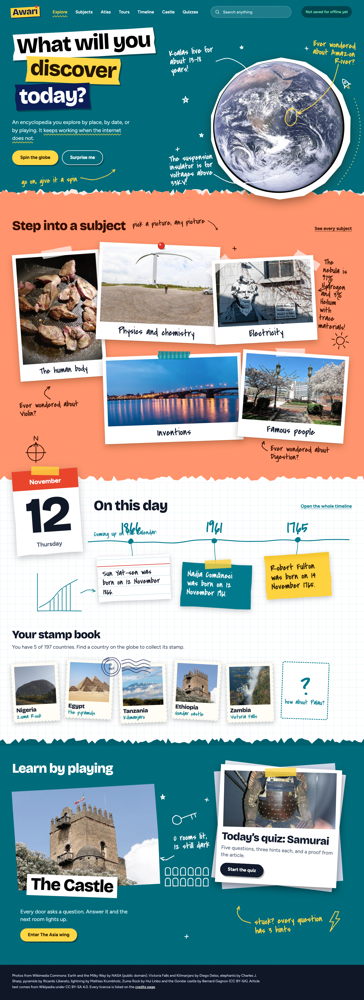

# Awari

**Awari** (Yoruba for *discovery*) is a free, offline-first encyclopedia for
curious students aged about 9 to 14. It is built for the Kiroween 2026
hackathon, **Resurrection** category: Awari is inspired by Encarta and the
CD-ROM encyclopedias of the 1990s, and brings back what they did best, a whole
library that works with no network, wandering from one thing to the next, and
learning that feels like play.



Awari is an original design. It shares no name, logo, layout or artwork with
any product of the past. Everything on screen is hand-made in code: photo
prints with tape and pins, headlines on paper strips, wobbly SVG doodles.

## What you can do

- **Read** photo-led articles on 197 countries (every one of Africa's 54) and
  12 electricity topics. **Tap any word** to see its meaning in a side card.
- **Spin the globe.** Open a country to see its facts, its article and its
  quiz. Countries you open turn into **postage stamps** in your stamp book,
  counted out of Africa's 54.
- **Take quizzes.** Five questions per article and three hints for each: a
  nudge, where to look, then two wrong answers removed. A right answer shows
  the exact sentence from the article that proves it. Right and wrong are
  always said in words, never colour alone.
- **Walk the Castle.** A trivia castle where each correct answer lights the
  next of twelve rooms.
- **Wander the timeline** of 123 dates, and see what happened **on this day**.
- **Go offline.** After one visit, every feature above works in airplane mode.
  Your progress lives on your device; there are no accounts and no tracking.

## Run it

Needs Node.js 20 or later (22 recommended). No network is needed to build,
because the content packs are committed.

```sh
npm ci
npm run dev                     # http://127.0.0.1:5173
npm run build && npm run preview   # the production build, with the service worker
```

Useful commands:

| Command | What it does |
| --- | --- |
| `npm run check` | lint, typecheck, all tests, credits, hard rules, build, bundle budget |
| `npm run offline-check` | serves the build, visits once, goes offline, opens every feature |
| `npm run packs` | rebuilds the content packs from open data (needs network on first run) |
| `npm run submission-check` | the gate: hard rules, credits, documents, secret scan, `check` |
| `npm run log -- --spec … --task … --note …` | appends to `docs/kiro-log.md` |

The optional quiz service and the Terraform for hosting are described in
[`infra/terraform/README.md`](infra/terraform/README.md) and
[`docs/runbook.md`](docs/runbook.md). The app works without the quiz service.

## How Kiro was used

Awari was built end to end with Kiro, and the repository keeps the evidence.

- **Specs** (`.kiro/specs/`): 13 specs, each with `requirements.md` in EARS
  with numbered acceptance criteria, a `design.md` that derives numbered
  **correctness properties**, and a `tasks.md` ticked as work lands. Every
  property became a property-based test (fast-check), 87 of them named
  `Property N:` with the requirements they cover.
- **Steering** (`.kiro/steering/`): `product`, `tech`, `structure`, `design`
  (the art-direction brief, word for word) and `hackathon-rules` (the hard
  rules, enforced by a script).
- **Hooks** (`.kiro/hooks/`): lint and tests on save, a credits check when a
  bundled file changes, a log entry when a spec task is ticked, and a
  hard-rule guard when the agent stops.
- **Chat-driven coding**: the build followed the brief spec by spec. The
  [Kiro log](docs/kiro-log.md) records, with dates, which spec, hook or
  steering file drove each piece of work, including the bugs the properties
  caught (a quiz hint that gave away its answer; margin-note facts that were
  not in the article; a Castle answer that hid its own proof sentence).

## Content and licences

Code is MIT (see [`LICENSE`](LICENSE)). Content is openly licensed, and every
bundled photo and data file is credited in [`CREDITS.md`](CREDITS.md):

| Content | Source | Licence |
| --- | --- | --- |
| Articles | Simple English Wikipedia | CC BY-SA 4.0 |
| Facts and timeline dates | Wikidata | CC0 |
| Globe shapes | Natural Earth | Public domain |
| Word meanings | Open English WordNet | CC BY 4.0 |
| Photos | Wikimedia Commons | per photo, in `CREDITS.md` |
| Fonts | Bricolage Grotesque, Figtree, Covered By Your Grace | SIL OFL 1.1 |

Every article page shows its text and photo credits.

## Project layout

```
.kiro/       steering, specs, hooks (the Kiro evidence)
src/         the app: features/, design/, lib/, sw/ (service worker)
scripts/     content pack pipeline, gates, service worker build, offline check
public/      generated packs and photos (committed)
services/    the optional quiz Lambda (Amazon Bedrock)
infra/       Terraform: S3, CloudFront, Lambda
docs/        brief, Kiro log, Devpost write-up, video script, judge guide
```
