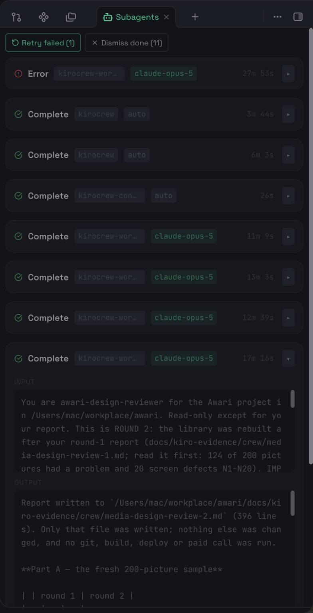
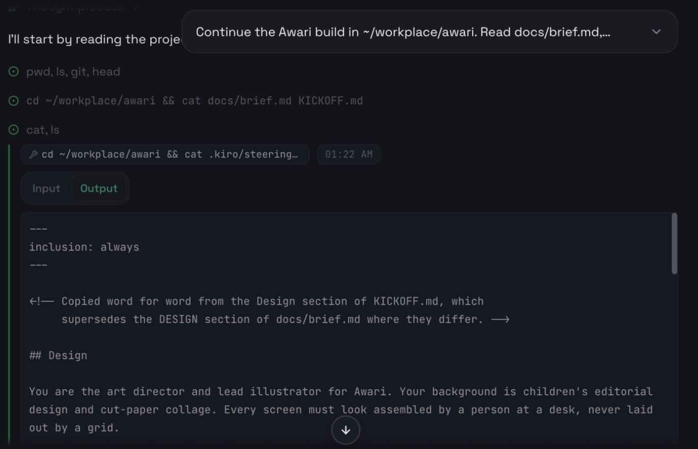
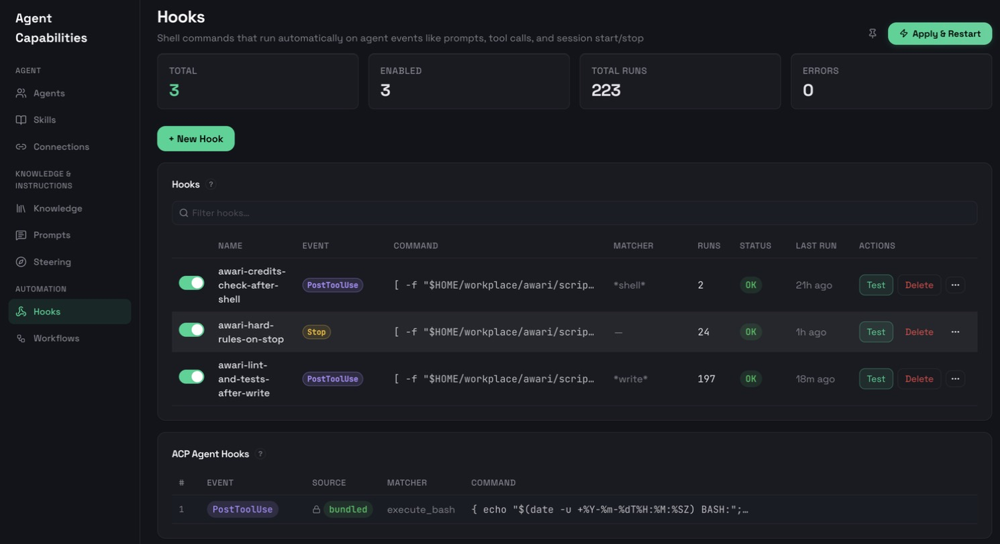

# I rebuilt the 1990s CD-ROM encyclopedia as a web app that works in airplane mode

*This post was written as part of the Kiroween 2026 hackathon (blog-post bonus). Live app: https://d3txwsv4mn6ye9.cloudfront.net. Code (MIT): https://github.com/ogasege/awari. Suggested tags: `kiro`, `kiroween`, `offline-first`, `react`, `aws`.*

When I was young, an entire encyclopedia came on one shiny disc. You put it in the computer and
everything was just there: no loading, no connection, no account. You could start at a photo of a
volcano and end up, twenty minutes later, in a quiz about rivers. I wanted that feeling back for
children who today have a phone, a patchy connection, and the biggest encyclopedia ever written
that they cannot count on.

So I built **Awari** (Yoruba for *discovery*) for the Resurrection category of Kiroween 2026. It
is a free web app for curious students: <!--n:countries-->197<!--/n--> countries and
<!--n:subjectArticles-->274<!--/n--> articles across <!--n:subjects-->11<!--/n--> subjects, a globe
with guided tours, quizzes whose hints teach, a trivia castle, a timeline, and a stamp book for
every country in the world. Search any topic and, online, any Simple English Wikipedia article
opens in the same page and is kept for later. After one visit, the bundled library works with the
network off. Try it: https://d3txwsv4mn6ye9.cloudfront.net. The code is MIT: https://github.com/ogasege/awari.

## Three ideas I kept from the disc

**Everything is on the disc.** The content is static JSON built from open data. A hand-written
service worker saves it all on the first visit and fails the install whole if any file is
missing, so you never end up with half an encyclopedia. A script switches a real browser offline
and opens every feature to prove it.

**One thing leads to another.** Every article links to the globe, its quiz and the castle; every
word can be tapped; countries you open become stamps.

**Learning that feels like play.** Each quiz question has three hints: a nudge, where to look,
then two wrong answers removed. A right answer shows the exact sentence from the article that
proves it.

## How Kiro shaped it

I built it in Kiro Crew, spec first: <!--n:specs-->26<!--/n--> specs with EARS requirements, a
design that turns them into correctness properties, and tasks, each committed on its own. The
specs paid off when I widened the scope to the whole world. Writing them first made me ask what
Wikidata's "inception" date means for a country, and the answer (often not independence: Nigeria's
is 1963, the year it became a republic) became a rule. A curated date has to agree with Wikidata
or the event stays out.

Three custom Kiro agents did the narrow jobs. A **builder** carries my steering files and runs
hooks after every write (lint, type checks, the related tests) and when it stops (the
hackathon's hard rules, as code). A read-only **licence auditor** found that one country's photo
showed a town of the same name on the other side of the world. A read-only **design reviewer**
opened screens in a browser through the Playwright MCP server and told me, fairly, that two new
pages "could have been made by a template". It also caught a margin note about an elephant
being shot. Kids' reference needs that kind of second reader.

<!--n:properties-->118<!--/n--> property-based tests guard the rules that matter, such as "a hint
never contains the answer", which caught a hint that said "the 1960s" for an answer of 1960.

### Kiro in use

*Crew's Subagents panel: twelve sub-agent runs for the build session (eleven complete, one error).*

*Steering in use: Kiro reads the design file first.*

*Crew's Hooks panel on 14 November: three hooks, 223 runs, 0 errors.*

Not everything worked, and the write-up says so: a crew member died on a backend error, a review was too big to send, the
offline claim was too broad until the owner caught it on the live site, and the first quiz hint gave the answer away in most
questions until an independent reviewer found it. All four were fixed and are listed in the repository.

## What's next

Local-language editions with the same pipeline and the same licence checks, and a teacher mode.
Thank you to the volunteers behind Simple English Wikipedia, Wikidata, Natural Earth, Open English
WordNet and Wikimedia Commons. Awari is theirs.
