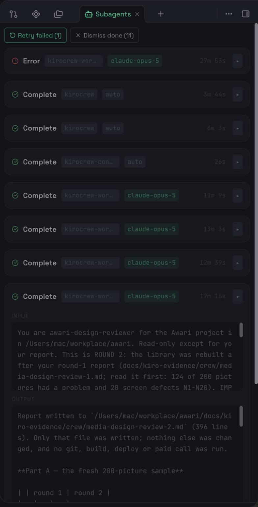
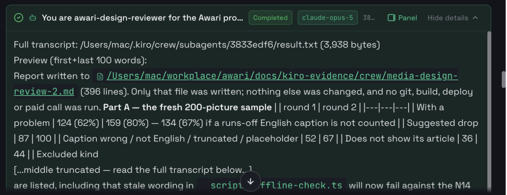
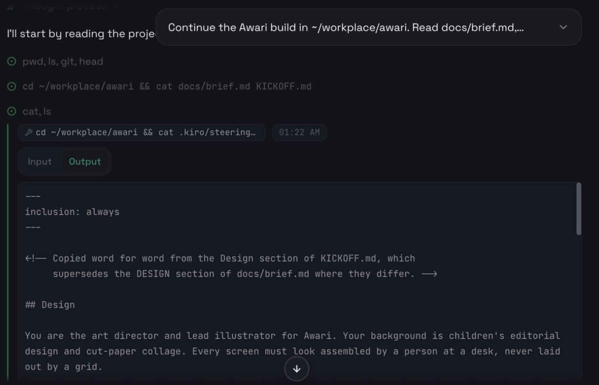
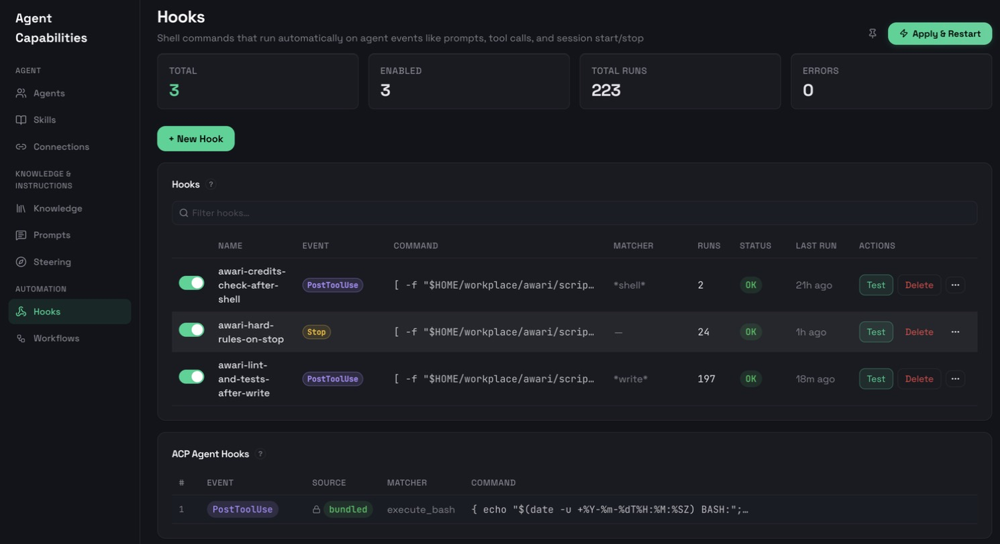
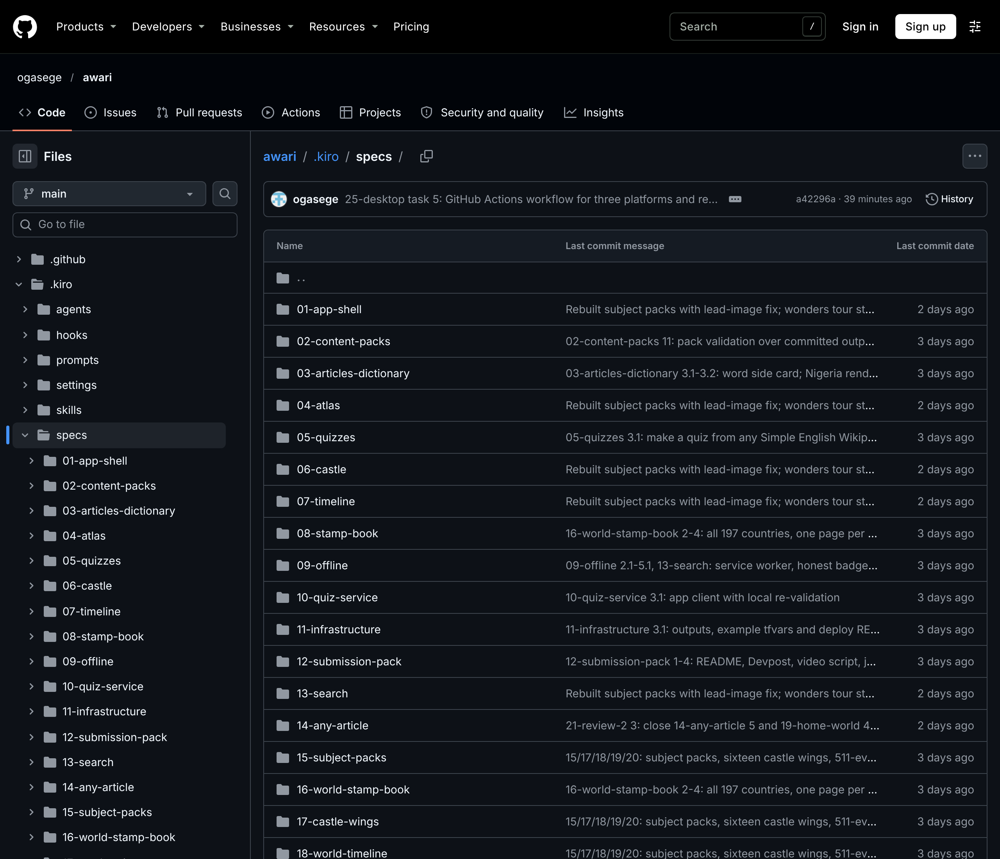
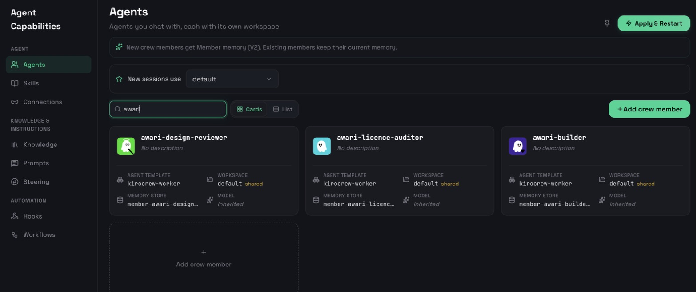

# Awari: Devpost write-up

**Category:** Resurrection
**Tagline:** The 1990s CD-ROM encyclopedia, brought back as a free web app for the whole world that works in airplane mode.

> Before submitting, fill the three placeholders: `[LIVE URL]`, `[GITHUB URL]` and `[VIDEO URL]`
> (see `docs/runbook.md`). The numbers below are filled in by `npm run stats`.

## Inspiration

Awari is inspired by Encarta and the CD-ROM encyclopedias of the 1990s. I wanted to know why
they felt so good. The whole library sat on a disc, so it worked with no network. One thing led
to another: a photo, a map, a word you did not know. And it was playful, with quizzes and games
tucked between the articles.

Today, curious children in many places have a phone, a patchy connection and the largest
encyclopedia ever written, and still cannot rely on it. So the resurrection is not nostalgia; it
is the disc's best ideas, made free, open and small enough to carry. *Awari* is Yoruba for
discovery.

## Who it is for and why it matters

Awari is for children of about 8 to 14, and for the parents and teachers who share one phone or one
school computer where the connection is patchy or costs real money. The problem is not new, and these
figures come from the organisations that measure it:

- **Data costs more where people earn less.** In the ITU's *Facts and Figures 2024*, a subscriber in a
  low-income economy pays 19 times as much of their income for the standard mobile data basket as a
  subscriber in a high-income economy, and one in a lower-middle-income economy pays about 6 times as
  much ([ITU, Affordability of ICT services](https://www.itu.int/itu-d/reports/statistics/2024/11/10/ff24/)).
- **Half the world's schools are not connected.** Giga, the ITU and UNICEF school-connectivity initiative,
  reported in July 2024 that about three million schools, roughly half of the estimated total, are still
  not connected to the internet
  ([Giga, July 2024](https://giga.global/giga-galvanizes-global-efforts-to-accelerate-school-connectivity/)).
- **Few people are online in the poorest countries.** For 2024 the ITU estimates that 93 per cent of people
  in high-income countries use the internet, against 27 per cent in low-income countries
  ([Giga, citing ITU](https://giga.global/global-digital-development-what-the-stats-say/)).

What Awari shows, rather than claims: one visit to the live site saves the whole encyclopedia (about
41 MB of articles, quizzes, maps, the atlas and every lead photo), after which it works with no
connection in the browser, as an installed app, and as a desktop app for Windows, macOS and Linux. A
child can then read, search, play the Castle and take quizzes with the connection switched off. The
extra library pictures (about 86 MB) are optional: kept as they are viewed, or all at once with one
button, and the desktop app includes them.

What it is not: the content is Simple English Wikipedia, selected and checked by rules, not written by
experts, and the quizzes are generated by rules from the article text with the proof sentence shown for
every answer. It is not a curriculum, it has no sound, and the picture selection is automatic and not
hand-curated. A teacher should treat it as a very good starting point for curiosity.

## What it does

- **Search any topic.** Online, any Simple English Wikipedia article opens on demand (English
  Wikipedia when Simple has none) in the same photo-led page, with credits, a quiz built on the
  device and tap-a-word meanings. Every article read is saved, so it opens offline later.
- **A library on the disc**: <!--n:countries-->197<!--/n--> countries and
  <!--n:subjectArticles-->274<!--/n--> articles in <!--n:subjects-->11<!--/n--> subjects, with
  <!--n:photos-->476<!--/n--> licence-checked Commons photos, a page per subject, and a dictionary of
  <!--n:lemmas-->14,593<!--/n--> words.
- **A globe** you can spin and **guided tours** that turn it from stop to stop: great rivers,
  wonders of the ancient world, volcanoes of the Ring of Fire.
- **A stamp book** with a page per continent, counted out of all <!--n:countries-->197<!--/n-->
  countries.
- **Quizzes with a hint ladder**: <!--n:quizzes-->479<!--/n--> quizzes,
  <!--n:questions-->2360<!--/n--> questions, three hints each (a nudge, where to look, two wrong
  answers removed), and the proof sentence after a right answer. Right and wrong are said in
  words.
- **The Castle**: <!--n:wings-->16<!--/n--> wings, one per continent and one per subject, twelve
  rooms each.
- **A timeline** of <!--n:events-->1530<!--/n--> dates across every subject and continent, and **On
  this day** on Home, which also rotates its prints, notes and suggestions daily.
- **A picture library** of <!--n:mediaPictures-->3720<!--/n--> Commons pictures (four or more per article but <!--n:mediaGaps-->25<!--/n-->, <!--n:mediaMB-->82<!--/n--> MB of small WebP copies): an article strip, a large view with the credit, a Pictures screen, the picture of the day and picture questions. No licence is typed by hand: `npm run licences` asks the Commons API about <!--n:mediaVerified-->4216<!--/n--> images and fails the submission check on any mismatch.
- **Offline**: a hand-written service worker saves the whole bundle. After one visit every bundled
  feature works in airplane mode, and the header says honestly whether the site has been saved. The core (articles, quizzes, maps, lead photos) is saved on the first visit; the 3,720 extra library pictures (about 86 MB) are kept as they are viewed, or all at once from Credits, and a picture not yet saved shows a placeholder, not a broken icon.
- **An optional quiz service** (AWS Lambda calling Amazon Bedrock) that checks every generated
  question against the article before a student sees it. The app never depends on it.

## How it differs from what exists

- **Reading Wikipedia online** gives the facts but needs a connection, and it is built for looking
  things up, not for wandering.
- **Offline Wikipedia readers such as [Kiwix](https://kiwix.org/)** bring the pages offline and are a
  good answer to the same problem. They are readers of the original articles; they do not add quizzes,
  tours, a map to explore or progress to keep.
- **Children's encyclopedia sites** are curated and friendly, but they need a connection.

Awari is built for exploring and play, not only lookup: a Castle of rooms with questions, guided tours,
a stamp book, a spinning atlas and a timeline, with every quiz answer shown beside the sentence that
proves it. It combines five public datasets by rules: Simple English Wikipedia, Wikidata, Natural Earth,
Open English WordNet and Wikimedia Commons, and every picture licence is verified against the Commons
API (`npm run licences`). Everything is saved in the browser or the desktop app, with no account.

## Download

Awari is also a download for Windows (`.exe`), macOS (`.dmg`, Apple silicon and Intel) and
Linux (`.AppImage`) from the [Releases page](https://github.com/ogasege/awari/releases). It is the same build as the website with every
pack and small picture inside, so it works with no internet from the first launch; bigger pictures
still come from Wikimedia Commons when online. The installers are **not code-signed**: on macOS,
right-click the app and choose Open; on Windows, choose More info, then Run anyway. Only the macOS
build was opened and tested by hand; the Windows and Linux builds come from the
`Desktop installers` workflow (`.github/workflows/desktop.yml`) and were not run by hand.

## How we built it

React 19, TypeScript and Vite, with hand-made components for the scrapbook look and no UI
framework. The main script is <!--n:mainScriptKB-->270<!--/n--> KB, under the 300 KB budget;
packs load on demand. Content is built by one command, `npm run packs`, from Simple English
Wikipedia, Wikidata, Natural Earth, Open English WordNet and Wikimedia Commons, and every record
carries its source and licence. Infrastructure is Terraform (private S3 behind CloudFront, and
an optional least-privilege Lambda); <!--n:terraformTests-->13<!--/n--> Terraform tests run with mock
providers.

## How we used Kiro

Everything below can be checked in the repo: `.kiro/`, `docs/kiro-log.md` and
`docs/kiro-evidence/`.

### Kiro surfaces (IDE, CLI, Web, Crew)

All build sessions ran in **Kiro Crew**, driven by chat: the brief, then "continue" messages, then
a world-scope brief and a rules-alignment brief from the owner. The first sessions ran Claude
inside Kiro Crew (Crew's Claude Code agent backend); the rest ran on Crew's Kiro CLI backend
(`docs/kiro-log.md`, Sessions table). Crew held the long build; the **Kiro CLI** ran three
custom agents for narrow jobs with their own tools, hooks and MCP servers. The Kiro IDE and Kiro
Web were not used. The Home design reference (`design/`) and the brief (`KICKOFF.md`) were
prepared outside Kiro before the first session.

### Kiro in use (screenshots)

These are real captures of the Kiro Crew desktop app and the public repository, taken on 14 November 2026 (the full set
of 23 is in [`docs/kiro-evidence/screenshots/`](kiro-evidence/screenshots/README.md)).

*The Subagents panel: twelve sub-agent runs (eleven complete, one error), and the brief given to one `awari-design-reviewer` run.*

*That run opened: the transcript path and the report file it wrote (`docs/kiro-evidence/crew/media-design-review-2.md`).*

*Steering in use: at the start of the session Kiro reads `.kiro/steering` and loads the design file.*

*Crew's Hooks panel on 14 November: three hooks, 223 runs, 0 errors.*

*`/.kiro/specs` in the public repository: one folder per spec.*

*The three crew members. This picture shows they exist; which of them actually ran is in `docs/kiro-evidence/crew/README.md`.*

### Custom agents

- **`awari-builder`** carries the steering files as resources, the hooks below, and the Terraform
  and AWS documentation MCP servers. Its shell settings deny `git push`, `terraform apply` and
  `terraform destroy`. It rebuilt packs, added tests and committed tasks
  (`aaa2b79`, `c1dc8a8`, `b1a5071`).
- **`awari-licence-auditor`** is read-only (deny-by-default shell). It found that the Central
  African Republic's photo showed Bangui in the Philippines, which the automatic photo check had
  accepted because the file named the capital, and a wrong font author.
- **`awari-design-reviewer`** is read-only with the Playwright MCP server. It found that the new
  Subject and Tour screens broke design rules 3 to 6 ("a template could have made this"), and a
  margin note saying an elephant "was shot". All were fixed, and margin notes now refuse such
  sentences, with a property test.

### Agent hooks

`awari-builder` has `postToolUse` hooks (after a source file is written: eslint, typecheck and the
related tests; after a pack build or a change under `public/`: `npm run credits`) and a `stop`
hook (`npm run rules`, the hackathon hard rules). Kiro fired them <!--n:hookFirings-->27<!--/n-->
times in real sessions, each logged with its Kiro session id. Crew's own Hooks panel, with three Crew hooks, counted 223 runs
and 0 errors on 14 November (picture above); those runs are the panel's count, not lines in the log. The hooks earned their place: a
firing exposed a bug in the hook script itself (a Vitest option that no longer exists), and
another showed the hook missed a type error in a new test, so it now runs the type checker
(`docs/kiro-evidence/hooks.md`). The `.kiro/hooks/*.kiro.hook` files hold the same checks for the
Kiro IDE; they have not fired, because the IDE was not used.

### Kiro powers

The catalogue on this machine lists 26 Kiro powers. I installed HashiCorp's **Terraform** power, because the AWS stack
(`infra/terraform`) is real work in this repository. Installing it by catalogue name timed out (it clones over SSH), so it
went in from a clone of the public powers repository by local path (`kiro-cli powers install <path>`), and
`~/.kiro/powers/installed.json` records it. I used the power's `terraform-best-practices` steering as a checklist against
the live stack: provider pins, validated inputs, default tags, no IAM wildcards (the only `*` is the explicit Deny of
insecure transport) and git-ignored state and variables all meet it; remote state does not (local state, one owner). Its
MCP server was not started, so only the power's steering text was used (`docs/final-review/kiro-power.md`).

### What I tried that did not work

- **A crew member died.** The `awari-builder` run `34363b32` ended on a backend 5xx after fetching its data and before wiring
  it in; I finished spec 22 by hand.
- **A review was too big.** The design reviewer run `8b50276e` failed with "Request exceeds the maximum allowed size" when I
  handed it 40 full-page screenshots. Later runs got contact sheets of about 1.6 MB.
- **A hook missed things.** It called a Vitest option that no longer exists, and it ran lint and tests but not the type
  checker, so a type error got through; both are fixed (`docs/kiro-evidence/hooks.md`).
- **Filtering was not enough for pictures.** Three review rounds measured 62%, 80% and 82% of sampled pictures with a problem.
  Spec 24 added 214 hand decisions, and the independent review in spec 26 found more (captions cut off, wrong lead pictures).
- **Safety rules blocked good commands.** Crew refused long shell heredocs as an "ssh to localhost", `curl | shasum` as
  `curl | sh`, an S3 upload and any push to `main`. I redid each edit with the file tool and short commands, and the owner
  pushed and deployed by hand.
- **A model was not available.** Claude Haiku 5.5 was refused for this AWS account, so the quiz service uses Haiku 4.5
  through an inference profile.
- **"Works offline" was too broad.** The owner found ten of twelve pictures broken offline on the first article; the notice,
  the strip and every document were reshaped (`docs/final-review/findings.md`, F-001).
- **A hint gave away the answer.** The independent reviewer found that the first hint named the answer in 96% of quiz
  questions; it was rebuilt (D-1).

### Spec-driven development

<!--n:specs-->26<!--/n--> specs, each with EARS requirements and numbered acceptance criteria, a
design that derives correctness properties, and tasks; <!--n:specTasksDone-->218<!--/n--> of
<!--n:specTasks-->228<!--/n--> tasks are done, each committed as `<spec> <task>: 
`. The
difference from vibe coding showed most when the scope grew to the whole world: specs 14 to 20
were written before any code. The design for the timeline made us check what Wikidata's
"inception" means, found that it is often not a country's independence day, and turned that
into a rule: a curated date must agree with Wikidata or the event is left out. A review pass over
specs 1 to 13 then found and fixed a bug no test covered (the Castle's buttons were yellow text
on yellow).

### Steering

Five steering files: `product`, `tech`, `structure`, `design` (the art-direction brief word for
word) and `hackathon-rules`. The design file was the yardstick for every screen and the
reviewer agent's instructions; the hackathon rules are code (`npm run rules`) that runs on every
stop hook and in `npm run submission-check`.

### MCP

`awari-builder` used the **HashiCorp Terraform MCP server** (provider docs for
`aws_lambda_function_url`, `aws_lambda_permission` and `aws_cloudfront_origin_access_control`) and
the **AWS Documentation MCP server** (the CloudFront guide for Lambda function URL origins) to
review the infrastructure: it confirmed the origin access control signing settings, both Lambda
permissions and the `x-amz-content-sha256` header the app must send, with ten tool calls listed
in `docs/kiro-evidence/terraform-mcp-review.md`. `awari-design-reviewer` used the **Playwright MCP
server** to open screens at laptop and phone widths and check overflow and focus. An earlier
Terraform server we tried was deprecated and would not start, so it was replaced rather than
listed.

### Property-based testing

<!--n:properties-->118<!--/n--> fast-check tests are named `Property N:` with the requirements they
cover. Defects they caught (`docs/kiro-evidence/properties.md`):
- *05-quizzes, Property 6* ("a hint never gives the answer away") caught year nudges like "the
  1960s" for an answer of 1960 (`be247ac`).
- *18-world-timeline, Property 2* ("a curated date that disagrees with Wikidata yields no event")
  left out 21 independence days, including Nigeria's (Wikidata gives 1963, the year it became a
  republic) and the United States' (`6084f8d`).
- *Margin notes are suitable* removed 16 article notes and a Home note (`b1a5071`).

## Challenges

- **Honest content.** Every handwritten fact is an article sentence word for word; every quiz
  answer has a proof sentence; every timeline sentence is a fixed template over Wikidata fields.
- **Pictures for ideas.** A scenic photo search works for countries and fails for "light bulb" or
  "Vikings". Subject packs now use each article's own lead image, and every photo was checked by
  eye on contact sheets before release.
- **Open data is messy.** Some English labels exist only through a shared language code; some
  countries' Wikidata dates mean something else.
- **Offline for real.** `npm run offline-check` switches a real browser offline and opens every
  feature, including an article read from Wikipedia while online.

## What's next

Local-language editions (Yoruba, Swahili, Hausa) with the same pipeline and licence checks, a
teacher mode that shares a quiz set as a link, and search over full article text.

## Built with

React, TypeScript, Vite, d3-geo, fast-check, Vitest, Playwright, Terraform, Amazon S3, Amazon
CloudFront, AWS Lambda, Amazon Bedrock, Kiro (Kiro Crew, Kiro CLI, custom agents, hooks, MCP).

## Links

- Live app: https://d3txwsv4mn6ye9.cloudfront.net
- Code (MIT): https://github.com/ogasege/awari
- Video: [VIDEO URL]
